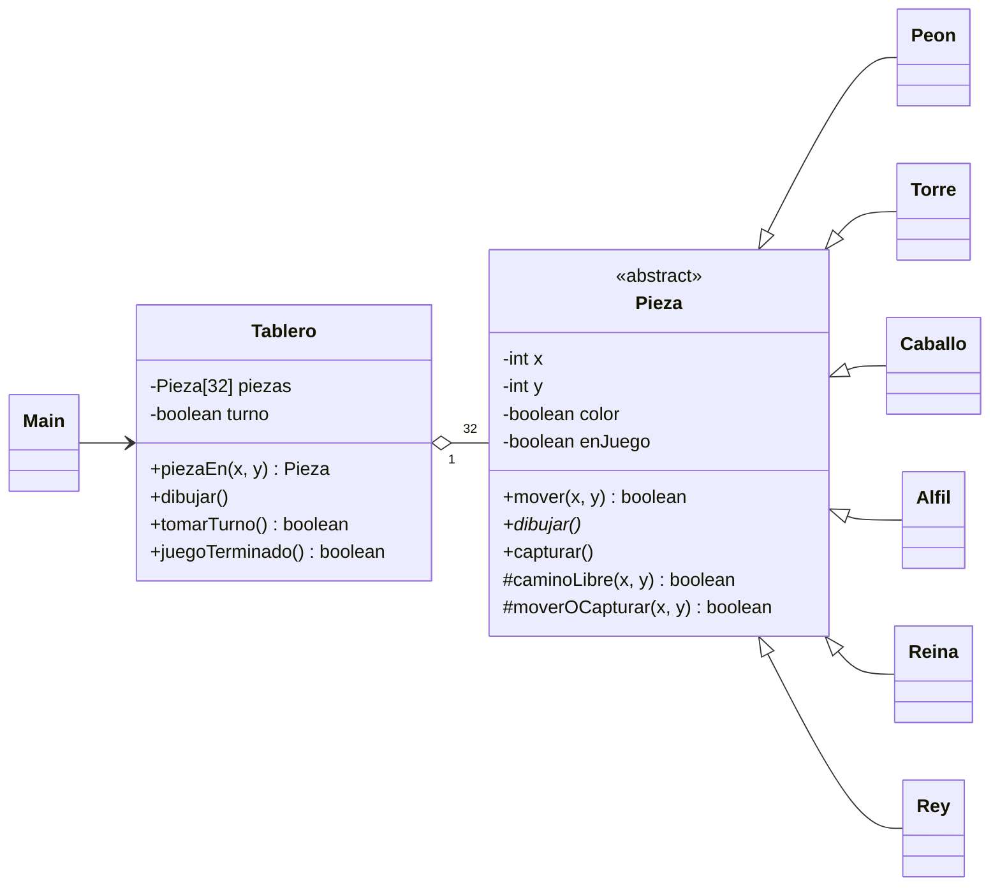

<div align="center">

# ♟️ Ajedrez en Consola — Java

**Juego de ajedrez para dos jugadores en la terminal, construido con programación orientada a objetos**


</div>

---

## 📋 Descripción

Dos jugadores se turnan escribiendo movimientos en notación de coordenadas (por ejemplo `e2e4`). El tablero se dibuja en la consola con colores ANSI y cada pieza valida sus propias reglas de movimiento. La partida termina cuando uno de los reyes es capturado.

```
   a  b  c  d  e  f  g  h
8  T  C  A  W  R  A  C  T  8
7  P  P  P  P  P  P  P  P  7
6                          6
5                          5
4                          4
3                          3
2  P  P  P  P  P  P  P  P  2
1  T  C  A  W  R  A  C  T  1
   a  b  c  d  e  f  g  h
```

> En la consola las piezas blancas se ven en **cian**, las negras en **rojo**, y las casillas alternan entre dos tonos oscuros.

| Símbolo | Pieza | Movimiento |
|:---:|---|---|
| `P` | Peón | Avanza 1 casilla (2 desde su posición inicial) y captura en diagonal |
| `T` | Torre | Línea recta horizontal o vertical |
| `C` | Caballo | En "L"; puede saltar piezas |
| `A` | Alfil | Diagonal |
| `W` | Reina | Recta o diagonal |
| `R` | Rey | Una casilla en cualquier dirección |

## 🧠 Diseño orientado a objetos



- **Herencia:** `Pieza` es una clase abstracta con lo común a todas las piezas (posición, color, captura, dibujo).
- **Polimorfismo:** cada pieza sobrescribe `mover()` con sus propias reglas; el tablero sólo llama a `pieza.mover(x, y)` sin saber qué pieza es.
- **Reutilización:** la torre, el alfil y la reina comparten `caminoLibre()` para revisar que no haya piezas en medio.

## 📁 Estructura del proyecto

```
Ajedrez/
├── src/
│   └── ajedrez/
│       ├── Main.java            # Punto de entrada y ciclo del juego
│       ├── Tablero.java         # Tablero, turnos y fin de partida
│       └── piezas/
│           ├── Pieza.java       # Clase base abstracta
│           ├── Peon.java
│           ├── Torre.java
│           ├── Caballo.java
│           ├── Alfil.java
│           ├── Reina.java
│           └── Rey.java
├── .gitignore
└── README.md
```

## ⚙️ Cómo compilar y ejecutar

Requisitos: **JDK 17 o superior** ([Adoptium](https://adoptium.net/)).

```bash
# Compilar
javac -encoding UTF-8 -d out src/ajedrez/*.java src/ajedrez/piezas/*.java

# Ejecutar
java -cp out ajedrez.Main
```

También puedes abrir la carpeta en **IntelliJ IDEA** o **VS Code**, marcar `src/` como carpeta de código fuente y ejecutar `ajedrez.Main`.

> **Windows:** si los acentos se ven raros en la terminal, ejecuta antes `chcp 65001`. Los colores funcionan en Windows Terminal, PowerShell y la terminal de VS Code.

## 🎮 Cómo jugar

1. Empiezan las **blancas** (filas 1 y 2).
2. Escribe la casilla de origen y la de destino juntas, sin espacios: `e2e4` mueve la pieza de **e2** a **e4**.
3. Si el movimiento no es válido, el juego lo indica y repite el turno.
4. Para capturar, mueve tu pieza a la casilla de una pieza rival.
5. Gana quien capture el rey contrario.

**Partida de ejemplo (gana blancas en 5 jugadas):**

```
e2e4   e7e5
d1h5   b8c6
f1c4   g8f6
h5f7   a7a6
f7e8   → ¡Piezas Blancas ganan!
```

## 🚧 Limitaciones y posibles mejoras

Esta versión implementa los movimientos básicos de cada pieza. Quedan como mejoras futuras:

- Detección de **jaque** y **jaque mate** (hoy la partida termina al capturar el rey).
- **Enroque**, **captura al paso** y **promoción** del peón.
- Guardar y cargar partidas, o usar notación algebraica (`Nf3`, `O-O`).

---

<div align="center">

Hecho por **Erick Isaac Guzmán Paniagua**

</div>
